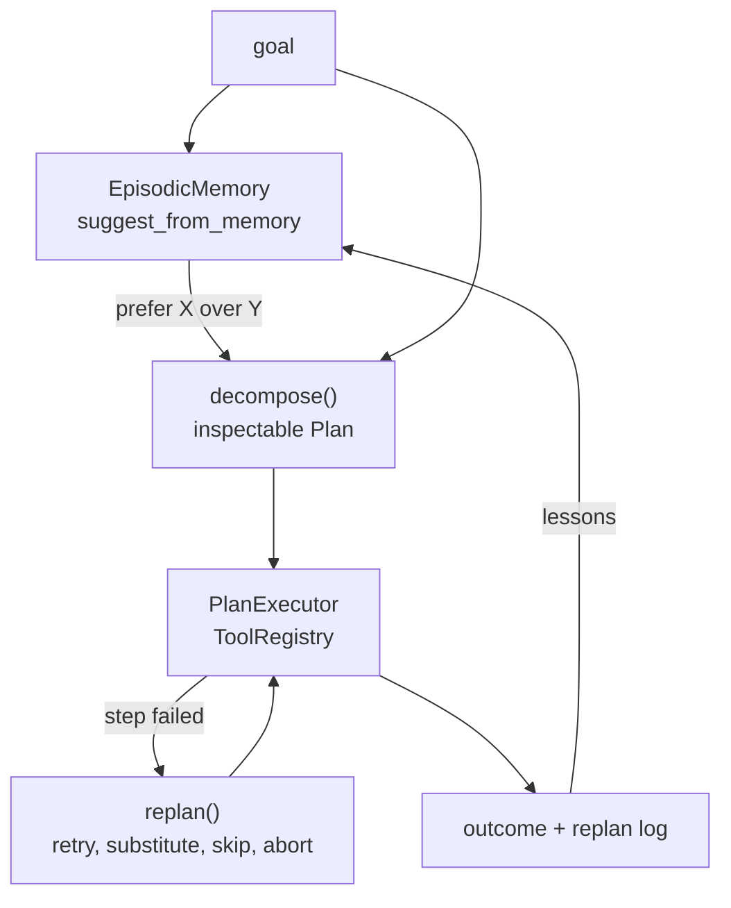

# Jagadish-deep-agents

[](https://github.com/jagadishmazure-jpg/Jagadish-deep-agents/actions/workflows/ci.yml)
[](https://github.com/jagadishmazure-jpg/Jagadish-deep-agents/actions/workflows/codeql.yml)


**Plan-and-execute agents that recover mid-run and learn across runs: an inspectable plan, four bounded replanning strategies, and episodic memory that changes the next plan. Deterministic and offline.**

> Personal learning and portfolio project. Everything runs offline on synthetic,
> fictional data with no API keys. Nothing is deployed. Numbers in this README
> come from real runs and are re-checked by CI (`scripts/render_docs.py --check`).

## Recruiter summary

- Covers the two things that separate fragile agent loops from robust ones: recovery from tool failure and memory across runs.
- Real run: the primary search fails twice, the agent retries then substitutes a fallback tool and succeeds; on the next run memory swaps the tool up front and no replanning is needed. With both tools down it aborts cleanly.
- Deterministic offline tests; CI with lint, CodeQL, gitleaks and documented-output drift checks.

## Purpose

A linear agent loop fails on the first tool error and forgets everything
between runs. This repo builds the plan before acting, recovers from failures
with a bounded set of strategies, and records lessons that shape the next plan.
Tools are deterministic fakes with failure injection so every path is testable.
Notes: [knowledge/](knowledge/README.md), [docs/memory-design.md](docs/memory-design.md).

## Architecture



## How it works

1. `DeepAgent.run(goal)` asks memory for lessons such as "prefer fallback_search over web_search".
2. `decompose()` builds a plan from rule templates; steps reference earlier outputs as `$sN.output`.
3. Memory lessons rewrite matching pending steps before anything runs.
4. `PlanExecutor` runs each step. On failure `replan()` picks, in order:
   retry with simplified args, substitute an alternative tool, skip a
   non-critical step (plan marked degraded), or abort with partial results.
   A replan budget bounds it, and each decision is logged with a reason.
5. The run is stored as an episode (task, plan, outcome, lessons) in JSONL.

## Real code and output

```python
"""Run 1: primary search fails twice and the agent recovers. Run 2: memory applies the lesson."""
import tempfile
from pathlib import Path

from deepagents import DeepAgent, EpisodicMemory
from deepagents.execute import ToolRegistry

with tempfile.TemporaryDirectory() as tmp:
    memory = EpisodicMemory(str(Path(tmp) / "memory.jsonl"))

    registry = ToolRegistry()
    registry.fail_next("web_search", count=2)
    trace = DeepAgent(registry=registry, memory=memory).run("research EV pricing")
    print("Run 1 plan:")
    for s in trace.plan.steps:
        print(f"  {s.id} {s.tool:<16} {s.description}")
    print("Replan log:")
    for e in trace.plan.replan_log:
        print(f"  {e['step_id']} {e['strategy']}: {e['reason']}")
    print("Outcome:", trace.outcome, "| degraded:", trace.plan.degraded)
    print("Lessons recorded:", trace.episode.lessons)

    trace2 = DeepAgent(memory=memory).run("research EV pricing trends")
    print("Run 2 memory hits:")
    for h in trace2.memory_hits:
        print("  ", h)
    print("Run 2 replans:", len(trace2.plan.replan_log), "| outcome:", trace2.outcome)

    registry3 = ToolRegistry()
    registry3.fail_next("web_search", count=5)
    registry3.fail_next("fallback_search", count=5)
    trace3 = DeepAgent(registry=registry3).run("research EV pricing")
    print("Run 3 (both search tools down):", trace3.outcome)
    for e in trace3.plan.replan_log:
        print(f"  {e['step_id']} {e['strategy']}")
```

Output of `python examples/demo.py` (real run, re-checked in CI):

<!-- run: python examples/demo.py -->
```text
Run 1 plan:
  s1 fallback_search  Search the web for EV pricing
  s2 summarizer       Distill key facts about EV pricing
  s3 web_search       Search for alternatives to EV pricing
  s4 summarizer       Compare and recommend on EV pricing
Replan log:
  s1 retry_modified: step s1 failed on first attempt (injected failure in web_search); retrying web_search with simplified args
  s1 substitute_tool: step s1: web_search failed twice (injected failure in web_search); substituting fallback_search
Outcome: success | degraded: True
Lessons recorded: ['retry with simplified args often recovers a failed s1', "prefer fallback_search over web_search for 'research EV pricing'"]
Run 2 memory hits:
   step s1: memory lesson applied — fallback_search instead of web_search
   step s3: memory lesson applied — fallback_search instead of web_search
Run 2 replans: 0 | outcome: success
Run 3 (both search tools down): failed
  s1 retry_modified
  s1 substitute_tool
  s1 abort
```
<!-- /run -->

## How to run

```bash
git clone https://github.com/jagadishmazure-jpg/Jagadish-deep-agents.git
cd Jagadish-deep-agents
python -m pip install pytest      # no runtime dependencies
python -m pytest -q          # offline, no keys
python examples/demo.py
python scripts/render_docs.py --check   # documented output still matches
```

Test suite size (real collection, re-checked in CI):

<!-- run: python scripts/count_tests.py -->
```text
27 tests collected
```
<!-- /run -->

## Guardrails

- The plan exists as data before any tool runs, so it can be inspected or approved.
- Replanning is bounded by a budget; no unbounded retry loops.
- Skipping a step marks the plan degraded instead of hiding it.
- Every recovery decision is logged with its reason.

## Limitations

- Planner is rule templates, not an LLM; it handles a small set of goal shapes.
- Tools are fakes; failure is injected.
- Memory recall is keyword overlap, and lessons are parsed from fixed sentence patterns.
- Memory lessons are never expired, so a stale lesson keeps applying.

## Built vs planned

| Capability | Status | Where |
|---|---|---|
| Plan model and rule-based decomposition | Built | `deepagents/planning.py` |
| Executor and tool registry with failure injection | Built | `deepagents/execute.py` |
| Four replanning strategies, bounded | Built | `deepagents/replan.py` |
| Episodic memory (JSONL) | Built | `deepagents/memory.py` |
| LLM planner, real tools over MCP, vector recall | Planned | docs/implementation-guide.md |
| Human approval before abort on high-stakes goals | Planned | not started |

## Implementation guide

The step-by-step path from this offline build to an Azure deployment is in
[docs/implementation-guide.md](docs/implementation-guide.md). None of it has been
run; it is a plan.

## Related repositories

| Repo | How it relates |
|---|---|
| [Jagadish-multi-agent-orchestration](https://github.com/jagadishmazure-jpg/Jagadish-multi-agent-orchestration) | Coordinating several agents rather than one deep one |
| [Jagadish-langchain-langgraph-langsmith](https://github.com/jagadishmazure-jpg/Jagadish-langchain-langgraph-langsmith) | Plan-and-execute in a graph framework |
| [Jagadish-agentic-ai](https://github.com/jagadishmazure-jpg/Jagadish-agentic-ai) | Broader agent patterns |
| [Jagadish-llm-evals-observability](https://github.com/jagadishmazure-jpg/Jagadish-llm-evals-observability) | Tracing and evaluating agent runs |

## Documentation

- [Memory design](docs/memory-design.md)
- [Concepts](knowledge/01-concepts.md)
- [Diagrams](knowledge/02-architecture.md)
- [Implementation guide (Azure)](docs/implementation-guide.md)
- [Interview points](docs/interview-points.md)
- [Security policy](SECURITY.md)

## Project layout

```
deepagents/
  planning.py  Plan/Step model, decompose()
  execute.py   PlanExecutor, ToolRegistry, fake tools
  replan.py    recovery strategies, budget
  memory.py    EpisodicMemory (JSONL)
  agent.py     DeepAgent: memory, plan, execute, record
examples/demo.py  the run shown above
tests/       offline pytest suite
```

## License

MIT, see [LICENSE](LICENSE). All data is synthetic; every organisation and person is fictional.
